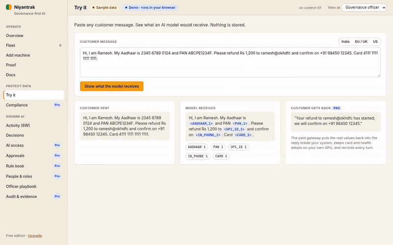
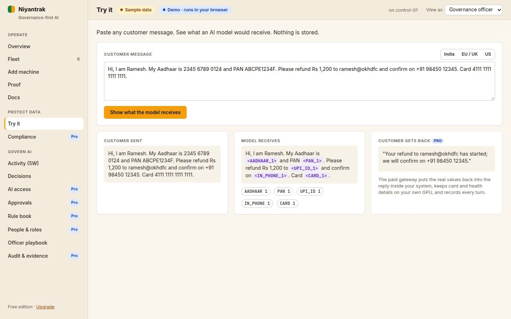
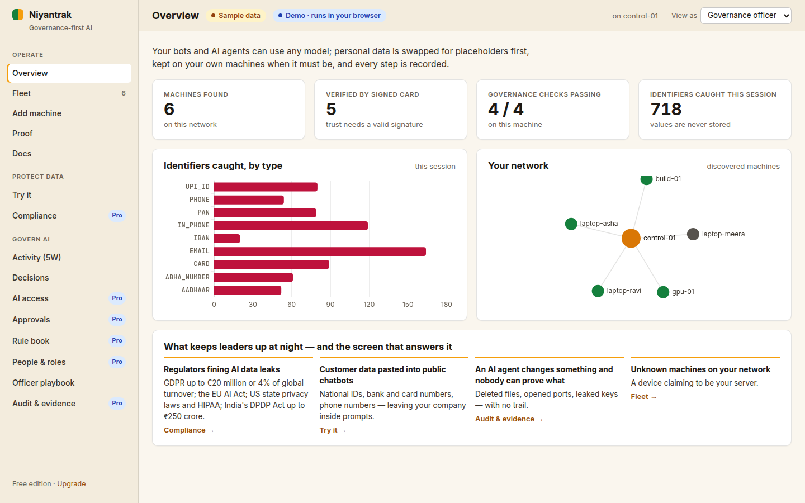
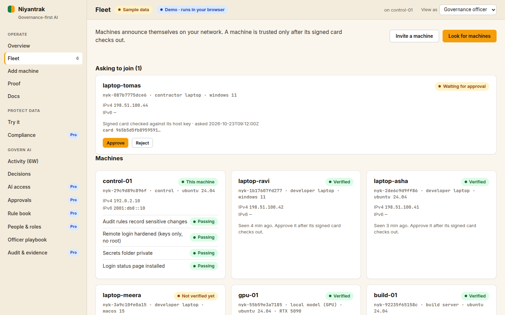
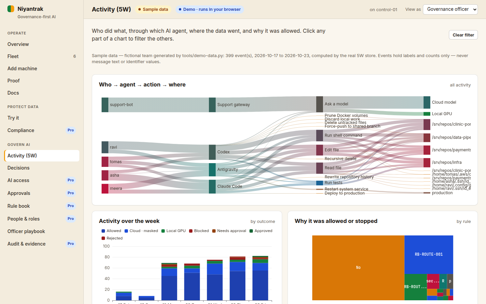
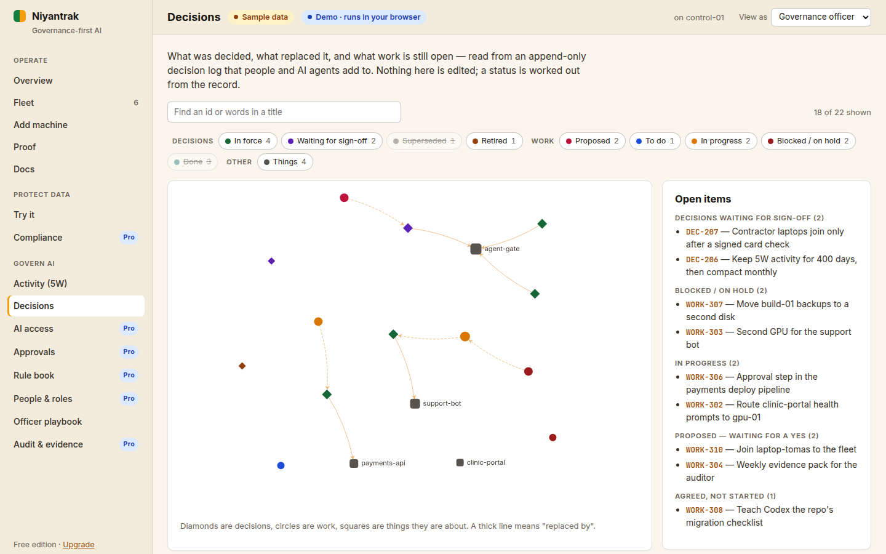
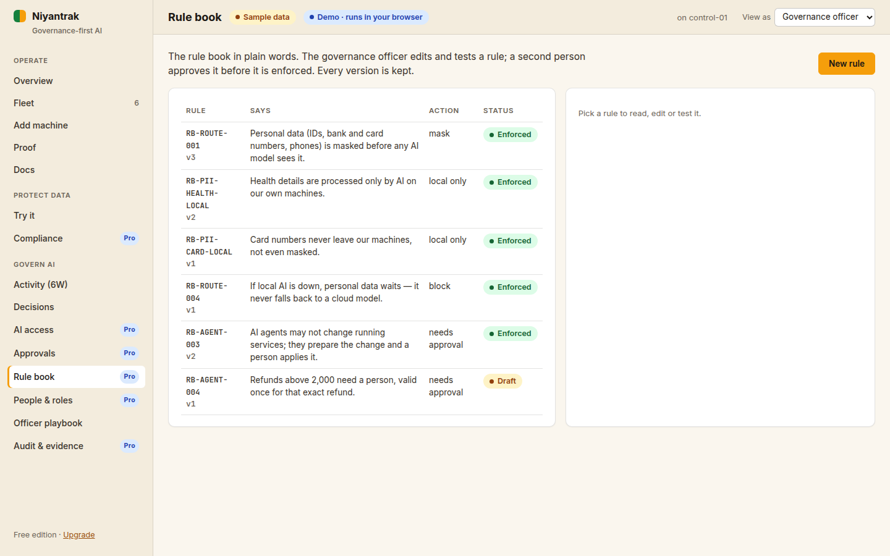
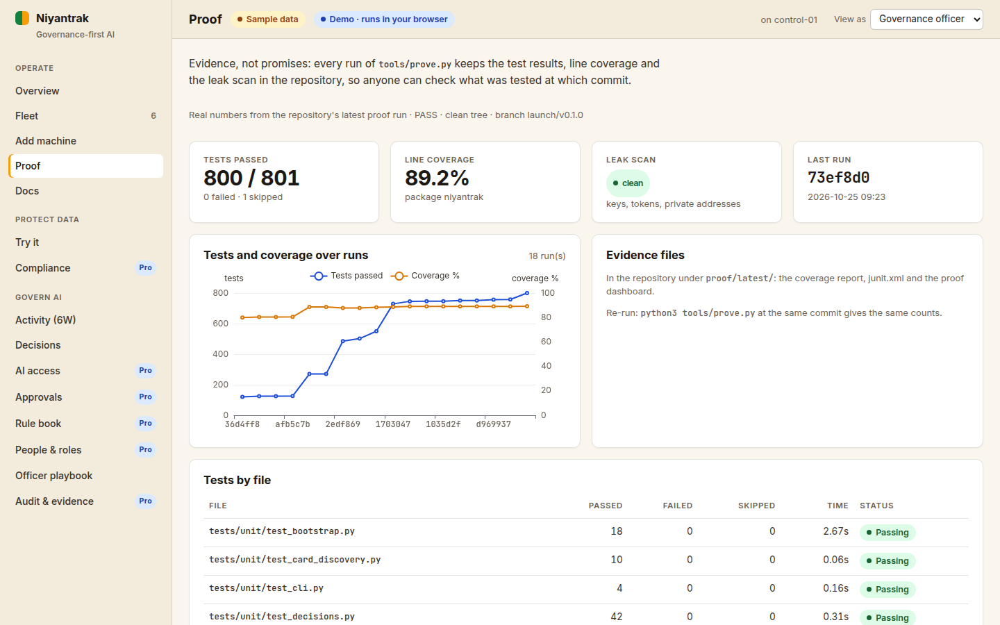

# Niyantrak

**What:** a governance layer for business bots and AI agents — it finds personal data before a model sees it, stops
dangerous agent actions, and records every decision as evidence. **Why:** so you can use any AI model without handing
it your customers' Aadhaar, PAN, card or phone numbers. **Where:** on machines you own; no cloud account needed.

> **Status: alpha (v0.1.0).** The free tools in this repository work and are tested on every commit, but interfaces
> may change before 1.0. Do not rely on it as your only control for regulated data yet. See [CHANGELOG.md](CHANGELOG.md).



*90-second walkthrough with a fictional sample team — [watch the video (MP4)](docs/media/niyantrak-walkthrough.mp4) ·
[WebM](docs/media/niyantrak-walkthrough.webm). Everything shown is sample data from `tools/demo-data.py`.*

Built in India, for the world, by VigyanBytes Solutions Private Limited. "Niyantrak" (नियंत्रक, *controller*) is a
working name pending trademark clearance. Licence: Apache-2.0.

## 60-second quickstart

You need Python 3.10 or newer. The free tools use the standard library only — nothing else is downloaded.
Not on PyPI yet: install from a clone of this repository.

**Ubuntu / Debian**
```bash
sudo apt install -y python3-venv git                 # once
git clone https://github.com/vigyanbytes/niyantrak.git && cd niyantrak
python3 -m venv .venv && .venv/bin/pip install .
.venv/bin/niyantrak scan "My Aadhaar is 2345 6789 0124, PAN ABCPE1234F, UPI ramesh@okhdfc"
.venv/bin/niyantrak panel                            # then open http://127.0.0.1:8770
```

**Windows 10/11** (PowerShell; WSL is **not** needed for the panel or the scan — not yet verified on real Windows, see [FAQ](docs/FAQ.md))
```powershell
winget install -e --id Python.Python.3.12; winget install -e --id Git.Git   # once, if missing
git clone https://github.com/vigyanbytes/niyantrak.git; cd niyantrak
py -3 -m venv .venv; .venv\Scripts\pip install .
.venv\Scripts\niyantrak scan "My Aadhaar is 2345 6789 0124, PAN ABCPE1234F"
.venv\Scripts\niyantrak panel                        # then open http://127.0.0.1:8770
```

What you should see:
```console
$ niyantrak scan "Hi, my Aadhaar is 2345 6789 0124, PAN ABCPE1234F, card 4111 1111 1111 1111. Pay ramesh@okhdfc or call +91 98450 12345."
A model would receive:
  Hi, my Aadhaar is <AADHAAR_1>, PAN <PAN_1>, card <CARD_1>. Pay <UPI_ID_1> or call <IN_PHONE_1>.

Found: AADHAAR 1, PAN 1, CARD 1, UPI_ID 1, IN_PHONE 1
```
Checksums, not guesses: an Aadhaar must pass Verhoeff, a card Luhn, an IBAN mod-97, a GSTIN its check character —
so order numbers and invoice ids are left alone. More detail: [docs/QUICKSTART.md](docs/QUICKSTART.md).

## Screenshots
The panel (`niyantrak panel`) showing a **fictional sample team** — asha, ravi, meera and tomas using Claude Code,
Codex and Antigravity on six machines for two weeks. The data is generated by `tools/demo-data.py` (fixed seed),
written through the real 5W store and decision log, and every screen is labelled *Sample data*. Recorded headlessly by
`tools/record-demo.py`; the test run keeps its own copies in [proof/latest](proof/latest/index.html).

| Try it — what a model would receive | Overview — governance checks and what was caught |
|---|---|
|  |  |
| **Fleet — machines and join approvals** | **Activity (5W) — who, which agent, what, where, why** |
|  |  |
| **Decisions — append-only log, derived status** | **Rule book** |
|  |  |
| **Proof — tests, coverage, leak scan** | |
|  | |

Build the same demo page yourself (needs the `[telemetry]` extra): `python3 tools/demo-data.py --out demo && python3
tools/build-demo.py demo/demo.html --bundle demo/bundle.json`, then open `demo/demo.html` in a browser.

## What is in the free edition
| Tool | Command | What it does |
|---|---|---|
| Identifier scan | `niyantrak scan` | India, EU, UK, US and global identifiers, checksum-validated; prints placeholders, never values |
| Web panel | `niyantrak panel` | Try-it screen, machine checks, fleet and join approvals, activity, decisions, as-built docs, proof |
| Agent gate | `niyantrak gate install --cli all` | hard stops for Claude Code, Codex, Gemini CLI, Antigravity and OpenCode: destructive commands, credential files, production changes |
| Join flow | `niyantrak panel --join-bind <addr>` | single-use token + card signed with the machine's SSH host key, over TLS pinned by fingerprint; operator approves |
| Decisions | `niyantrak decisions open` | append-only decision log; status derived, never edited in place |
| As-built docs | `niyantrak docs generate` | Markdown/HTML pages and a network map from node cards — same facts, byte-identical output |
| 5W activity | `niyantrak telemetry …` | who · whom · what · where · why events with counts only, tamper-evident store (`[telemetry]` extra) |
| 5W questions | `niyantrak telemetry ask "who ran destructive commands this week"` | plain-word question → the exact SQL → the answer; or `telemetry sql "SELECT …"`; table, CSV, JSON, Markdown, Parquet |
| Node bootstrap | `sudo bash bootstrap/niyantrak-bootstrap.sh --dry-run` | stock Ubuntu → hardened, audited node, with lock-out guards and resume (Linux only) |

How the pieces fit: [docs/ARCHITECTURE.md](docs/ARCHITECTURE.md). Common questions: [docs/FAQ.md](docs/FAQ.md).
Event format: [docs/5W.md](docs/5W.md). Asking the record questions in SQL: [docs/QUERYING_5W.md](docs/QUERYING_5W.md).
Security mapping to the OWASP LLM Top 10 (2025) and agentic AI threats: [docs/OWASP.md](docs/OWASP.md).
How the features relate to the EU AI Act, GDPR, ISO/IEC 42001 and 27001, NIST AI RMF, India's DPDP Act and other
regions (not legal advice): [docs/compliance/README.md](docs/compliance/README.md). Roadmap: [docs/ROADMAP.md](docs/ROADMAP.md). Launch status: [docs/LAUNCH_CHECKLIST.md](docs/LAUNCH_CHECKLIST.md).

Optional extras: `pip install ".[discovery]"` (mDNS, zeroconf), `".[telemetry]"` / `".[decisions]"` (pyarrow + duckdb),
`".[all]"`, `".[dev]"` (pytest, coverage, build).

## Ask the record questions
```console
$ niyantrak telemetry ask "Who ran destructive commands this week?" --as-of 2026-10-23
who    agent        machine       attempts  blocked  rules
-----  -----------  ------------  --------  -------  -----------------------------------------------
ravi   Codex        build-01      3         3        git.clean_force, git.force_push, git.reset_hard
asha   Codex        build-01      2         2        docker.data_loss, fs.rm_protected
meera  Claude Code  laptop-meera  1         1        git.history_rewrite
tomas  Codex        build-01      1         1        fs.rm_protected
(4 rows)
```
The SQL it ran is printed above the answer (shortened here), so every answer can be checked and re-run. No AI model is
involved, and queries are read-only. Ten questions with their SQL and real output: [docs/QUERYING_5W.md](docs/QUERYING_5W.md).

## Security: OWASP mapping
[docs/OWASP.md](docs/OWASP.md) maps Niyantrak to the **OWASP Top 10 for LLM Applications (2025)** and the **OWASP
Agentic AI threats (T1–T15)** with an honest *covered / partial / not yet* for each, plus a reading list. The short
version: no item is fully covered by the free edition; it gives hard limits and evidence for part of sensitive-data
disclosure (LLM02), excessive agency (LLM06), tool misuse, privilege compromise, repudiation, identity spoofing and
unexpected code execution (T2, T3, T8, T9, T11). Prompt-injection detection and resource limits are not there yet.

Laws and standards: [docs/compliance/](docs/compliance/README.md) maps the same features to the EU AI Act, GDPR,
ISO/IEC 42001 and 27001, the NIST AI RMF, India's DPDP Act and Rules with CERT-In, and the UK, US, Singapore and
Brazil, with *helps / partial / commercial / roadmap / yours* for each duty. It is our own reading, not legal advice.

## Editions & licensing
| | **Free** (this repo, Apache-2.0) | **Pro** | **Enterprise** | **Government / on-prem** |
|---|---|---|---|---|
| `niyantrak scan` — identifier detection with checksums (India, EU, UK, US, global) | ✅ | ✅ | ✅ | ✅ |
| Panel: try-it, machine checks, fleet join + approval, activity, decisions, docs, proof | ✅ (single operator, local) | hosted | self-hosted | air-gapped |
| Agent gate: hard stops for AI coding agents | ✅ | ✅ | ✅ | ✅ |
| Node bootstrap: stock Ubuntu → hardened, audited node | ✅ | ✅ | ✅ | ✅ |
| Redact-and-reclaim gateway (multi-turn, encrypted map with expiry and erasure) | — | ✅ | ✅ | ✅ |
| Jurisdiction profiles (DPDP, GDPR, more) and local-only routing | — | DPDP | all | all |
| Rule book compiled to gateway + AI agent policies, approvals | — | starter | full | full |
| Governance-officer roles, tamper-evident evidence packs | — | basic | ✅ | ✅ |
| Support | community | email | SLA | SLA + source escrow |

"DPDP-ready" means the product helps you meet your obligations; it does not by itself make an organisation compliant.
- **Free edition** — everything in this repository — is open source under **Apache-2.0**: use it, change it and
  redistribute it, including commercially, under the terms of `LICENSE` and `NOTICE`.
- **Pro, Enterprise and Government / on-prem** are separate commercial products under a proprietary licence. They are
  not in this repository. Contact **info@vigyanbytes.com**.
- **Contributions** are accepted under Apache-2.0 with a DCO sign-off (`git commit -s`); there is no CLA. Because
  Apache-2.0 permits it, VigyanBytes may also use contributed code in its commercial editions. See
  [CONTRIBUTING.md](CONTRIBUTING.md).

## Proof, not promises
Test evidence is kept in the repository as files, not claims: **[proof/latest/index.html](proof/latest/index.html)**
(dashboard), `junit.xml` (every test by name and outcome), `coverage/` (line coverage), `leak-scan.txt` and
`summary.json` (date, commit, counts, coverage). `proof/history.jsonl` gains one line per run. Runs up to v0.1.0
name commits of the development history before this public repository was created from a single fresh commit;
that first public commit holds exactly the tree of the last recorded run.
```bash
pip install ".[dev]" && python3 tools/prove.py --no-screens    # re-run it: same commit, same counts
python3 tools/leak-scan.py --history                           # every blob of every commit, plus commit metadata
```
CI runs the unit suite, coverage and the leak scanner on every push and uploads `proof/latest` as an artifact.
The panel shows the same numbers under **Operate → Proof**.

## Security, contributing, conduct
- Report vulnerabilities privately: [SECURITY.md](SECURITY.md). Please do not open a public issue for them.
- How to contribute: [CONTRIBUTING.md](CONTRIBUTING.md). Code of conduct: [CODE_OF_CONDUCT.md](CODE_OF_CONDUCT.md).

## Licence
Apache-2.0 for everything in this repository (`LICENSE`, `NOTICE`). The commercial editions are not in this repository
and are licensed separately — see [Editions & licensing](#editions--licensing).
