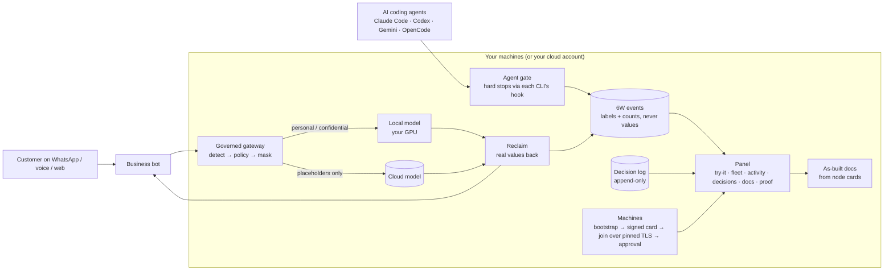
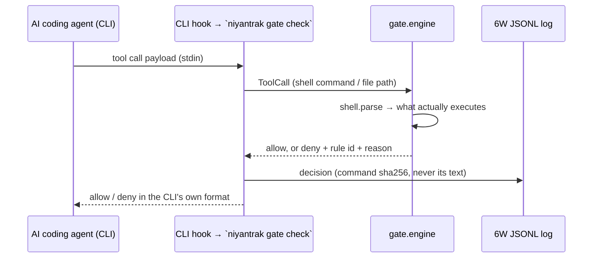

# Architecture

Niyantrak sits between the things that act (customer-facing bots, AI coding agents, operators) and the things that
can do damage (AI models, production machines, personal data). Every decision it makes is recorded as a 6W event:
**who** acted, on **whom**'s behalf, **what** they did, **where** the data went, **why** it was allowed or stopped and
**which** project, repository or workspace it touched — 6W (who, whom, what, where, why, which) + when.

## The whole picture

Evaluation edition (this repository): identifier detection, panel, agent gate, 6W events and store, decision log, as-built
docs, signed node cards, join flow, discovery, bootstrap. Commercial: the gateway (mask → route → reclaim), the rule
book compiler, roles and approvals, evidence packs.

## Components (evaluation edition)
| Component | Code | What it does | Trust boundary |
|---|---|---|---|
| Identifier scan | `niyantrak/recognizers.py`, `cli.py` | regex + checksum (Verhoeff, Luhn, mod-97, GSTIN, NHS mod-11, NPI, KVNR) per pack, region tag per recognizer; placeholders `<TYPE_n>` | never prints or stores values |
| Panel | `niyantrak/panel.py`, `web/` | standard-library HTTP server; static UI + JSON API | binds 127.0.0.1; join/approve accepted only from loopback |
| Agent gate | `niyantrak/gate/` | `engine` decides allow/deny with a rule id; `shell` parses what would actually execute; `adapters` speak each CLI's hook format; `installers` merge hooks without clobbering; `mode` enforce/audit/off | file contents written by an editor are data, never commands |
| 6W events | `niyantrak/telemetry/` | `schema` allow-lists fields and rejects free text and identifier values; `sink` accepts OTLP/HTTP JSON and plain JSON; `store` writes Parquet segments with a hash-chained manifest, DuckDB views | counts per type only; tamper-evident manifest |
| Decision log | `niyantrak/decisions/` | DECISION / WORK / THING events, append-only; status (open, superseded, closed) is derived, never stored | writer refuses secret-shaped text |
| As-built docs | `niyantrak/docs/` | Markdown + HTML + SVG network map from node cards and the join store; deterministic output | card text is untrusted and escaped; host keys only as sha256 |
| Node card | `niyantrak/card.py` | hardware, OS, addresses; signed with the machine's SSH host key (`ssh-keygen -Y`) | an announcement is a hint; the signature is the trust |
| Join | `niyantrak/join.py`, `tls.py` | single-use 256-bit token (only its sha256 stored) + signed card, over a TLS listener with a self-signed certificate pinned by fingerprint | listener serves only `POST /api/join`; key change ⇒ impersonation alert, token burnt |
| Discovery | `niyantrak/discovery.py` | mDNS `_niyantrak._tcp`, IPv4 + IPv6 | TXT carries only a hint (node id, card hash) |
| Bootstrap | `bootstrap/` | stock Ubuntu → hardened, audited node; lock-out guards, resume, dry run | root; every step recorded |
| Proof | `niyantrak/proof.py`, `tools/prove.py`, `tools/leak-scan.py` | junit, coverage, leak scan and screenshots kept in `proof/` per run | host names and absolute paths scrubbed |

## The agent gate

Hard-stop families: `destructive` (recursive deletes of roots or homes, disk formatting, raw block writes, zfs
destroy, history-rewriting git), `secret` (reading credential files by path), `production` (services, firewalls,
deployments, power). Modes per machine: `enforce`, `audit` (log, never block), `off`.

## Joining a machine
```mermaid
sequenceDiagram
  participant Op as Operator (panel, loopback)
  participant CN as Control node
  participant JL as Join listener (TLS :8771)
  participant M as New machine
  Op->>CN: Invite → token (shown once; sha256 stored) + cert fingerprint
  Op-->>M: one-liner: join URL, token, --pin sha256:…
  M->>JL: TLS handshake; refuse unless cert hashes to the pin
  M->>JL: POST /api/join {token, card, signature, host public key}
  JL->>CN: verify signature, token unused + unexpired, host key not changed
  CN-->>Op: machine listed as pending
  Op->>CN: Approve (loopback only in the evaluation edition)
```

## Data that is never kept
Message text, prompts, replies and identifier values are never written by the evaluation tools. The scan returns
placeholders and counts; 6W events hold labels and counts; the gate logs a command's sha256; the join store holds token
hashes and public keys. See [6W.md](6W.md) for the exact event schema.

## Running it
Today: bare-metal or VM nodes, Python (standard library) + shell, systemd, nginx; no Kubernetes needed. The panel and
the scan also run on Windows without WSL. Next: [ROADMAP.md](ROADMAP.md).
