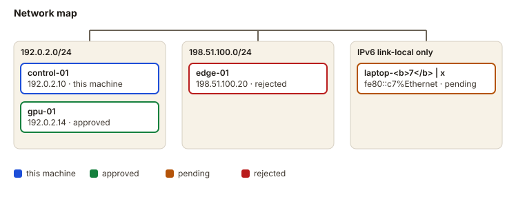

# Fleet as built

Generated by Niyantrak from signed node cards and the join store. The same facts always give the same files: there is no generation timestamp, so a page changes only when a machine changes.

4 machine(s): 1 approved, 1 pending, 1 rejected, 1 this machine.

## Machines

| host | node id | state | role | os | cpu cores | memory | gpu | addresses | page |
|---|---|---|---|---|---|---|---|---|---|
| control-01 | nyk-aaaaaaaaaaa0 | this machine | control | ubuntu 24.04 | 16 | 62.5 GB | — | 192.0.2.10, 2001:db8::10 | [details](node-nyk-aaaaaaaaaaa0.md) |
| gpu-01 | nyk-aaaaaaaaaaa1 | approved | worker | ubuntu 24.04 | 32 | 125.6 GB | Example GPU 32GB (32 GB) | 192.0.2.14, 2001:db8::14, fe80::14%eth0 | [details](node-nyk-aaaaaaaaaaa1.md) |
| laptop-&lt;b&gt;7&lt;/b&gt; \| x | nyk-aaaaaaaaaaa2 | pending | — | windows 11 | 8 | 15.7 GB | — | fe80::c7%Ethernet | [details](node-nyk-aaaaaaaaaaa2.md) |
| edge-01 | nyk-aaaaaaaaaaa3 | rejected | edge | ubuntu 26.04 | 4 | 7.8 GB | — | 198.51.100.20 | [details](node-nyk-aaaaaaaaaaa3.md) |

## Network map

## Governance

| host | state | decided by | decided at | checks passing |
|---|---|---|---|---|
| control-01 | this machine | — | — | 2 / 3 |
| gpu-01 | approved | operator@localhost | 2026-01-02T03:10:00Z | — |
| laptop-&lt;b&gt;7&lt;/b&gt; \| x | pending | — | — | — |
| edge-01 | rejected | operator@localhost | 2026-01-04T01:00:00Z | — |
